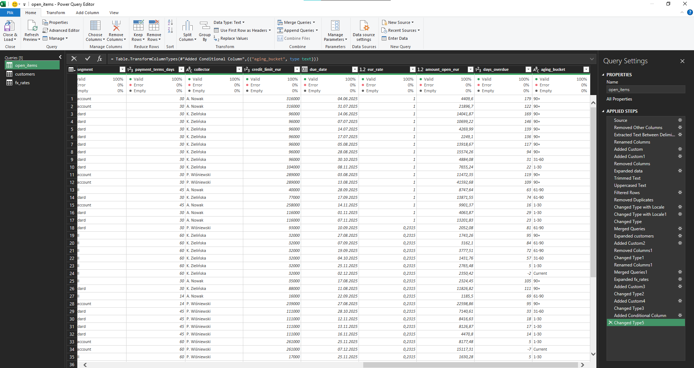
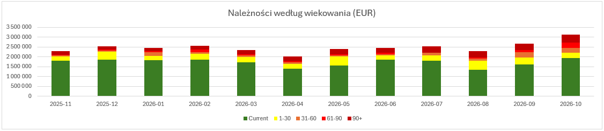
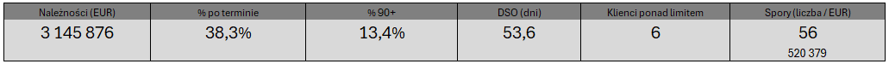
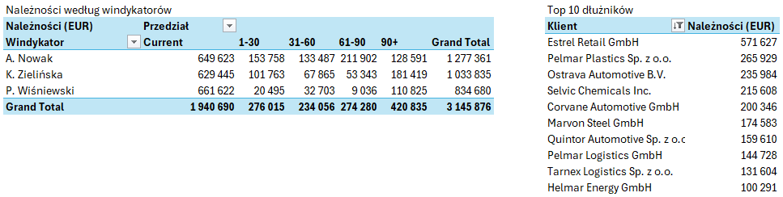
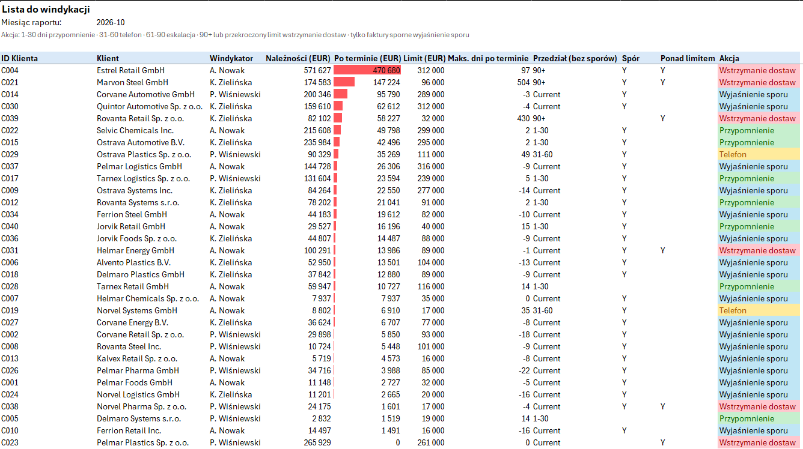
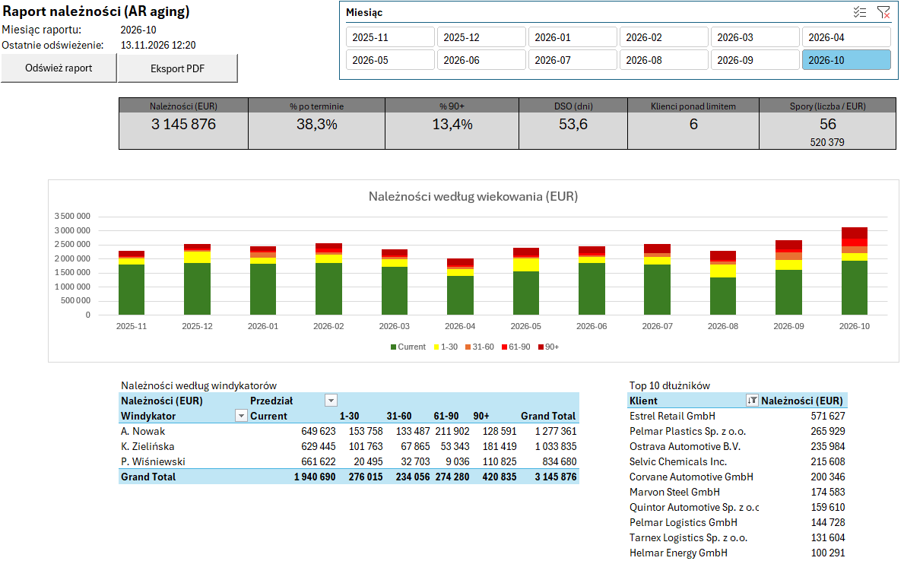
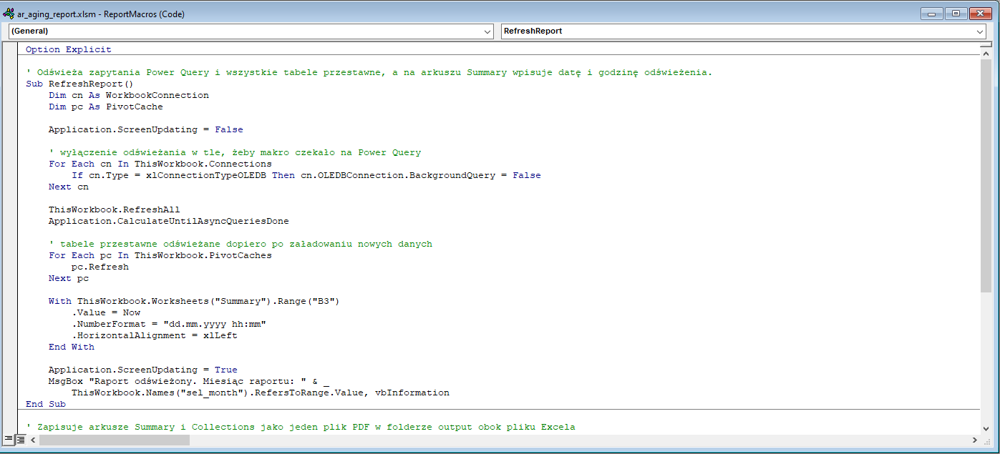

English · [Polski](README_PL.md)

# Monthly accounts receivable aging report in Excel

A monthly AR aging report built the way it is often done in finance shared service centres: raw ERP exports go into a folder, Power Query cleans and joins them, and a two-page Excel report with KPIs and a collections list updates after one click. The data is synthetic, generated by a short Python script that plays the role of the ERP system.

**Main result:** over 12 months receivables grew from **2.28 to 3.15 million EUR**, the overdue share rose from **21% to 38%** and DSO from **41.5 to 53.6 days**. One key account, Estrel Retail GmbH, is **83% over its credit limit** and alone accounts for **39% of the overdue amount**.

**Tools and methods:** Excel · Power Query (ETL from a folder of CSV files, merges, data cleaning) · pivot tables, PivotCharts, slicers · XLOOKUP, SUMIFS, COUNTIFS, MAXIFS, FILTER, SORT, IFS, dynamic arrays · conditional formatting · VBA (report refresh, PDF export) · Python (pandas, NumPy) for synthetic data

## Data and approach

The data imitates exports from an ERP system for 40 fictional customers in three currencies (EUR, PLN, USD), for 12 months from November 2025 to October 2026:

| File | Content |
|---|---|
| `data/open_items/AR_open_items_yyyy-mm.csv` | open invoices and credit notes at month end (12 files, 2,881 rows after cleaning) |
| `data/billing/AR_billing_yyyy-mm.csv` | invoices issued in the month (12 files, 1,832 rows), used for DSO |
| `data/customers.csv` | customer master data: payment terms, credit limit, collector (credit controller) |
| `data/fx_rates.csv` | month-end exchange rates to EUR |

The exports contain the usual problems of real ERP files, and Power Query fixes all of them:
- report title lines above the table and a TOTAL row at the bottom,
- customer IDs with extra spaces or lower-case letters, currency codes like `eur `,
- duplicated rows and missing due dates (filled as invoice date + payment terms),
- Polish number and date formats,
- the report month only in the file name.

Power Query reads the whole folder, so adding a new month means dropping a new file into it and clicking **Odśwież raport** (refresh report).



## Findings

### Receivables grow and get older

The total went up by 38% in a year, and the growth is mostly overdue money. The share of invoices more than 90 days overdue went from 7.8% to 13.4%.



### Customers pay more slowly

DSO (receivables at month end / sales in the month × 30 days) rose from 41.5 to 53.6 days. In October 6 customers are over their credit limit and 56 invoices worth 520 thousand EUR are disputed.



### One key account drives the problem

Estrel Retail GmbH has been over its credit limit since July 2026. In October it owes 572 thousand EUR against a limit of 312 thousand, and 82% of that is overdue.



### Disputes pile up

Disputed invoices went from 23 (381 thousand EUR) to 56 (520 thousand EUR). For 17 of the 32 customers on the October collections list the only overdue items are disputed ones, so the first step there is to solve the dispute, not to send reminders.



## Report

The report has two pages, both driven by the month slicer on the first one:



- **Summary:** KPI tiles, 12-month aging chart, receivables by collector and top 10 debtors.
- **Collections:** a list of customers to chase in the selected month with a suggested action. The rule: 1–30 days overdue → reminder, 31–60 → phone call, 61–90 → escalation, 90+ or credit limit exceeded → stop deliveries, only disputed items overdue → resolve the dispute. On this list disputed invoices are flagged and left out of the customer's aging bucket, so an old dispute does not block a customer by itself.

The selected month is read from the slicer through a small helper pivot table and stored in the named cell `sel_month`, which all KPI and collections formulas use.

A sample of the exported report: [AR_report_2026-10.pdf](excel/output/AR_report_2026-10.pdf)

### VBA

Two macros sit behind the buttons on the Summary sheet. `RefreshReport` refreshes the Power Query queries first and the pivot tables after them, then writes the refresh time. `ExportPDF` saves both pages to one PDF in `excel/output/`. The code is also exported to [ReportMacros.bas](excel/vba/ReportMacros.bas).



## Details and limitations

- The data is synthetic. The trends (slower payments, one deteriorating key account, more disputes) were built into the generator on purpose, to have something to find.
- DSO uses a simple formula with a 30-day month. Amounts are converted to EUR at month-end rates.
- Credit notes stay in the aging with negative amounts, as they would in the ERP.
- The Power Query source path is absolute, so after downloading the repo it has to be changed once (see below).

## How to run

1. Download the repo. Right-click `excel/ar_aging_report.xlsm` → **Properties** → tick **Unblock** → **OK** (otherwise Windows blocks the macros in a downloaded file).
2. Open the file and click **Enable Content**.
3. Point Power Query to your copy of the data: **Data → Get Data → Data Source Settings** → select each source → **Change Source** → choose the matching file or folder in `data/`.
4. Click **Odśwież raport** on the Summary sheet.

To generate the data again (optional):

```
python -m venv .venv
.venv\Scripts\python.exe -m pip install -r requirements.txt
.venv\Scripts\python.exe python/generate_data.py
```


Michał Narewski · MSc Computer Science and Econometrics, AGH University of Krakow · [GitHub](https://github.com/narewskimichal)
