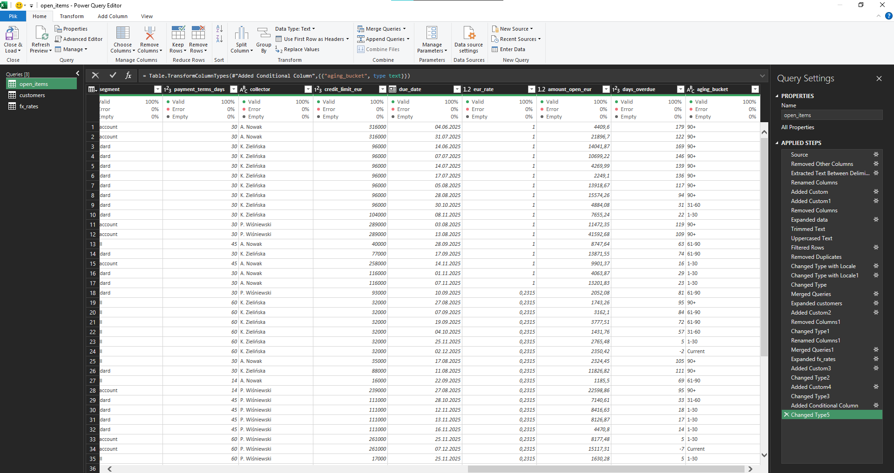
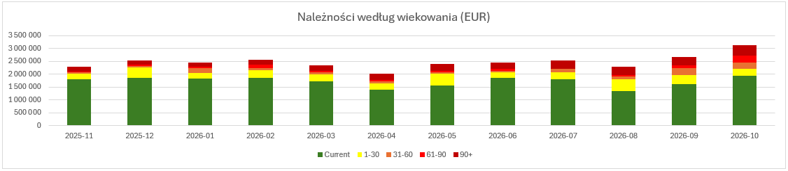
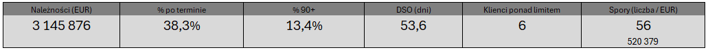
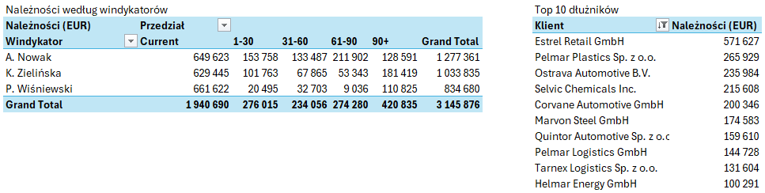
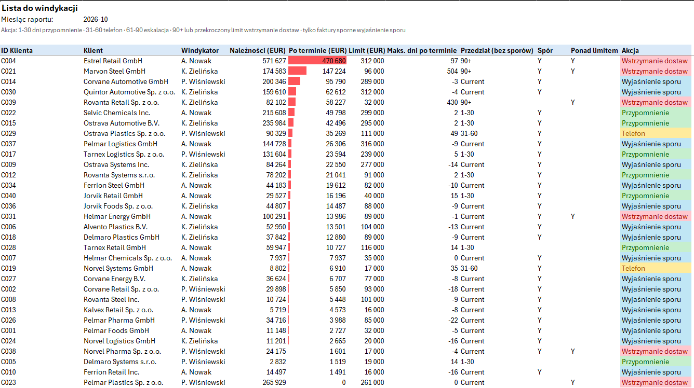
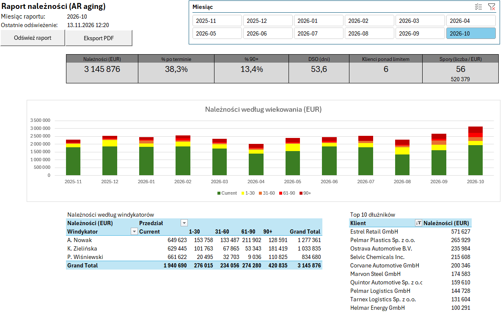
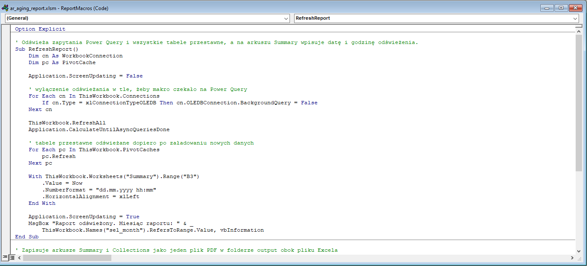

[English](README.md) · Polski

# Miesięczny raport wiekowania należności w Excelu

Miesięczny raport wiekowania należności (AR aging) zrobiony tak, jak często robi się to w centrach usług wspólnych: surowe eksporty z ERP trafiają do folderu, Power Query je czyści i łączy, a raport w Excelu z KPI i listą do windykacji aktualizuje się jednym kliknięciem. Dane są syntetyczne, tworzy je krótki skrypt w Pythonie, który udaje system ERP.

**Główny wynik:** w ciągu 12 miesięcy należności wzrosły z **2,28 do 3,15 mln EUR**, udział przeterminowanych z **21% do 38%**, a DSO z **41,5 do 53,6 dnia**. Jeden kluczowy klient, Estrel Retail GmbH, przekracza limit kredytowy o **83%** i odpowiada sam za **39% kwoty po terminie**.

**Narzędzia i metody:** Excel · Power Query (ETL z folderu plików CSV, scalanie, czyszczenie danych) · tabele przestawne, wykresy przestawne, fragmentatory · XLOOKUP, SUMIFS, COUNTIFS, MAXIFS, FILTER, SORT, IFS, tablice dynamiczne · formatowanie warunkowe · VBA (odświeżanie raportu, eksport do PDF) · Python (pandas, NumPy) do danych syntetycznych

## Dane i podejście

Dane naśladują eksporty z systemu ERP dla 40 fikcyjnych klientów w trzech walutach (EUR, PLN, USD), za 12 miesięcy od listopada 2025 do października 2026:

| Plik | Zawartość |
|---|---|
| `data/open_items/AR_open_items_rrrr-mm.csv` | otwarte faktury i noty kredytowe na koniec miesiąca (12 plików, 2881 wierszy po oczyszczeniu) |
| `data/billing/AR_billing_rrrr-mm.csv` | faktury wystawione w miesiącu (12 plików, 1832 wiersze), do DSO |
| `data/customers.csv` | kartoteka klientów: termin płatności, limit kredytowy, windykator |
| `data/fx_rates.csv` | kursy walut do EUR na koniec miesiąca |

Eksporty mają typowe problemy prawdziwych plików z ERP, a Power Query poprawia je wszystkie:
- tytuł raportu nad tabelą i wiersz TOTAL na dole,
- ID klientów ze spacjami lub małymi literami, kody walut w stylu `eur `,
- zduplikowane wiersze i brakujące terminy płatności (uzupełniane jako data faktury + termin z kartoteki),
- polskie formaty liczb i dat,
- miesiąc raportu tylko w nazwie pliku.

Power Query czyta cały folder, więc dodanie nowego miesiąca to wrzucenie nowego pliku i kliknięcie **Odśwież raport**.



## Wnioski

### Należności rosną i się starzeją

Suma należności wzrosła w ciągu roku o 38%, i to głównie przez kwoty po terminie. Udział faktur przeterminowanych o ponad 90 dni wzrósł z 7,8% do 13,4%.



### Klienci płacą wolniej

DSO (należności na koniec miesiąca / sprzedaż w miesiącu × 30 dni) wzrosło z 41,5 do 53,6 dnia. W październiku 6 klientów przekracza limit kredytowy, a spornych jest 56 faktur na 520 tys. EUR.



### Problem napędza jeden kluczowy klient

Estrel Retail GmbH przekracza limit kredytowy od lipca 2026. W październiku ma 572 tys. EUR należności przy limicie 312 tys., z czego 82% jest po terminie.



### Spory się nawarstwiają

Liczba spornych faktur wzrosła z 23 (381 tys. EUR) do 56 (520 tys. EUR). U 17 z 32 klientów na październikowej liście do windykacji jedyne kwoty po terminie to faktury sporne, więc pierwszym krokiem jest wyjaśnienie sporu, a nie przypomnienie o płatności.



## Raport

Raport ma dwie strony, obie sterowane fragmentatorem miesiąca na pierwszej:



- **Summary:** kafelki KPI, wykres wiekowania z 12 miesięcy, należności według windykatorów i top 10 dłużników.
- **Collections:** lista klientów do windykacji w wybranym miesiącu z sugerowaną akcją. Reguła: 1–30 dni po terminie → przypomnienie, 31–60 → telefon, 61–90 → eskalacja, 90+ lub przekroczony limit → wstrzymanie dostaw, po terminie tylko faktury sporne → wyjaśnienie sporu. Na tej liście faktury sporne są oznaczone flagą i nie wchodzą do przedziału wiekowania klienta, żeby stary spór sam nie blokował klienta.

Wybrany miesiąc jest odczytywany z fragmentatora przez małą pomocniczą tabelę przestawną i zapisany w nazwanej komórce `sel_month`, z której korzystają wszystkie formuły KPI i listy do windykacji.

Przykład wyeksportowanego raportu: [AR_report_2026-10.pdf](excel/output/AR_report_2026-10.pdf)

### VBA

Pod przyciskami na arkuszu Summary są dwa makra. `RefreshReport` najpierw odświeża zapytania Power Query, potem tabele przestawne i wpisuje godzinę odświeżenia. `ExportPDF` zapisuje obie strony do jednego PDF w `excel/output/`. Kod jest też wyeksportowany do pliku [ReportMacros.bas](excel/vba/ReportMacros.bas).



## Szczegóły i ograniczenia

- Dane są syntetyczne. Trendy (wolniejsze płatności, pogarszający się kluczowy klient, więcej sporów) zostały celowo wbudowane w generator, żeby było co znaleźć.
- DSO liczone jest prostym wzorem z miesiącem 30-dniowym. Kwoty przeliczane są na EUR po kursach z końca miesiąca.
- Noty kredytowe zostają w wiekowaniu z ujemnymi kwotami, tak jak w ERP.
- Ścieżka do danych w Power Query jest bezwzględna, więc po pobraniu repo trzeba ją raz zmienić (niżej).

## Jak uruchomić

1. Pobierz repo. Kliknij prawym przyciskiem `excel/ar_aging_report.xlsm` → **Właściwości** → zaznacz **Odblokuj** → **OK** (inaczej Windows zablokuje makra w pobranym pliku).
2. Otwórz plik i kliknij **Włącz zawartość**.
3. Wskaż Power Query swoją kopię danych: **Data → Get Data → Data Source Settings** → zaznacz każde źródło → **Change Source** → wybierz odpowiedni plik lub folder w `data/`.
4. Kliknij **Odśwież raport** na arkuszu Summary.

Ponowne wygenerowanie danych (opcjonalnie):

```
python -m venv .venv
.venv\Scripts\python.exe -m pip install -r requirements.txt
.venv\Scripts\python.exe python/generate_data.py
```


Michał Narewski · MSc Computer Science and Econometrics, AGH University of Krakow · [GitHub](https://github.com/narewskimichal)
